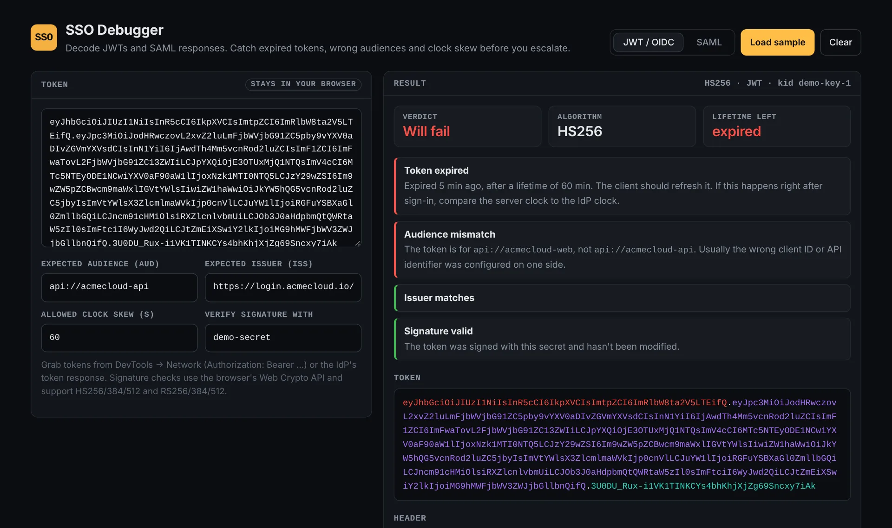

# SSO Debugger

Decode JWTs and SAML responses, verify signatures, and catch expired tokens, audience mismatches and clock skew before escalating an SSO ticket.

**Live demo → https://rajprasad19.github.io/sso-debugger/** (click **Load sample** to try it without real data)

## Features
- **JWT / OIDC:** decodes the header and claims with explanations for each claim; checks `exp`, `nbf` and `iat` against a configurable clock skew; checks `aud` and `iss` against expected values; flags `alg: none`; detects encrypted JWE and opaque tokens
- **Signature verification** with the Web Crypto API: HS256/384/512 with a shared secret, RS256/384/512 with a PEM public key
- **SAML:** accepts base64 POST values, URL-encoded or deflated Redirect-binding values, or raw XML. Checks status codes, signature placement (Response vs Assertion), the NotBefore/NotOnOrAfter window, audience vs SP entity ID, issuer, Destination vs Recipient, and empty NameIDs. Lists attributes and pretty-prints the XML
- **No backend.** Tokens never leave the browser

## How it works
Each check maps to a common real-world SSO failure, such as a stale IdP certificate, a trailing slash in an ACS URL, the wrong Okta authorization server, or server clock drift. The fix hint is written so a support engineer can act on it or hand it to the customer's IT team.

## Run locally
It's a single static file with no build step and no dependencies. Open `index.html` in a browser.

## Why I built it
I've spent years in support and support engineering roles (Wizards of the Coast, Dwelo), and these are the checks I kept doing by hand on escalations. This turns them into a two-second paste.

---
Built by [Raj Prasad](https://github.com/rajprasad19) · [LinkedIn](https://www.linkedin.com/in/raj-prasad-3a2669140/)
